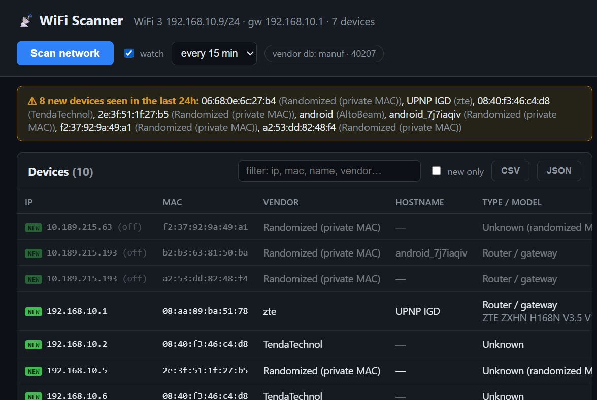

# User Guide — reading the dashboard

Open `http://127.0.0.1:3847` (the exe opens it for you) and press
**Scan network**. A full scan of a /24 takes **20–40 seconds**.

## Header

| Element | Meaning |
|---|---|
| Network line (`WiFi 3 192.168.10.9/24 · gw 192.168.10.1 · 7 devices`) | The adapter the scan used, its IP/prefix, the gateway, and how many devices answered *this* scan |
| **Scan network** | Starts a scan (only one runs at a time; the button shows progress) |
| **watch** + interval select | Watch mode — see below |
| `vendor db: manuf · 40207` | Which vendor database is loaded and how many MAC prefixes it knows. **Offline fallback (42)** means the download failed — see Troubleshooting |

## Watch mode (auto-scan + desktop notification)

Tick **watch** in the header and pick an interval (1 / 5 / 15 min or
hourly). The scanner then re-runs on its own and shows a **Windows toast
notification** whenever a *new* device (a MAC never seen before) appears —
useful for spotting a guest or an unfamiliar gadget without watching the
dashboard.

- The toast only fires for genuinely new MACs, not on every run.
- Hover the checkbox to see when the next scan is due.
- Watch mode is not remembered after you close the app — re-tick it next
  time (this avoids surprise background scans).
- Toasts suppressed? Set `WIFI_SCANNER_NO_TOAST=1` (see Install) or
  enable notifications for the app in Windows Settings.

## New-device banner

> ⚠ **8 new devices seen in the last 24h:** …

Appears when devices were **first** seen within the last 24 hours — useful
for noticing something new on your network (a guest, a stray IoT gadget, an
intruder). The **new only** checkbox uses the same 24 h rule, so the banner
and the filter always agree.

## Device table

| Column | What it shows |
|---|---|
| **IP** | Current address. `(off)` = not seen in the latest scan; the row keeps its last-known details and is dimmed |
| **MAC** | Hardware address. Green **NEW** badge = first seen within 24 h |
| **Vendor** | OUI → manufacturer (Apple, TendaTechnol…). **Randomized (private MAC)** = the device uses a per-network random MAC, so no vendor can be derived — this is normal for phones/laptops |
| **Hostname** | From mDNS/NetBIOS (`Sarahs-iPhone`, `DESKTOP-ABC`), or `—` if nothing announced one |
| **Type / model** | Best-guess device class plus exact model when known (`Router / gateway`, `Android device`, `printer`, …). A second line shows the concrete model (`ZTE ZXHN H168N V3.5`) |
| **Confidence** | `high` / `medium` / `low` — how firm the fingerprint is |
| **Ports** | Open TCP ports found on the live hosts |
| **Last seen** | When this MAC was last observed |

### Filters and export

- **Search box** — matches IP, MAC, hostname, vendor, or type live as you
  type.
- **New only** — shows only devices first seen in the last 24 h (same rule
  as the banner).
- **CSV / JSON** — downloads the whole stored device list (history across
  scans, up to 5000 rows) as a file. CSV opens directly in Excel; JSON
  keeps full structure for scripts. Columns: `mac, ip, vendor, hostname,
  type, model, confidence, first_seen, last_seen, notes`.

## Detail panel (click a row)

- Full **evidence list** — every signal that produced the fingerprint:
  "UPnP device description", "mDNS service _adb", "open port 22 (SSH)"…
- **Services** discovered via mDNS/SSDP (AirPlay, Chromecast, printers…)
- **Open ports** with detected service names
- **Notes** — your own label for the device ("kitchen speaker"), saved
  across scans
- **Hide/ignore** — removes the device from the list without deleting its
  history
- **Sighting timeline** — every time this MAC has been seen

## Interpreting results honestly

- **`(off)` rows are history, not ghosts.** They're devices this scanner
  has seen before but that didn't answer the latest scan — powered off,
  asleep, or out of range. They are *not* proof a device is present now.
- **Randomized MACs** can't be vendor-identified. Identify them by
  hostname, mDNS services, or port fingerprint instead — or check your
  router's client list, which often has the real name.
- **Empty-looking scan** usually means a client-isolated network (hotel,
  enterprise AP) where only the gateway responds. See
  [WINDOWS-vs-KALI.md](WINDOWS-vs-KALI.md).
- **Confidence levels:** `high` = concrete evidence (exact model from UPnP,
  SSH + HTTP banners); `medium` = strong hints (open ports + OUI);
  `low` = educated guess (OUI alone).
- **Scan twice.** A sleeping phone often wakes from the first sweep's
  traffic and answers the second.

## Tips

- The console window is the scan log — leave it open; closing it stops the
  scanner.
- Re-run the scan after connecting new gear; the banner flags anything new.
- Use **notes** liberally — "Tenda router", "Mom's iPad" — the table becomes
  a network inventory over time.
